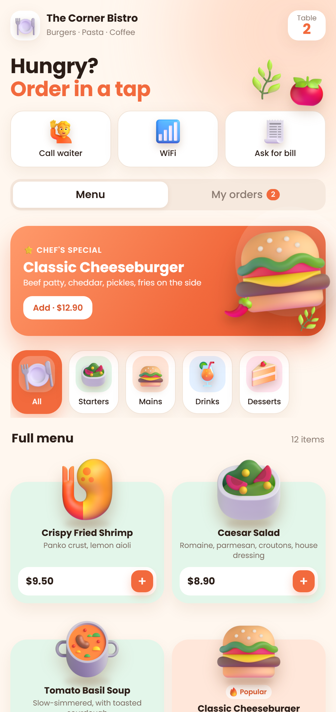
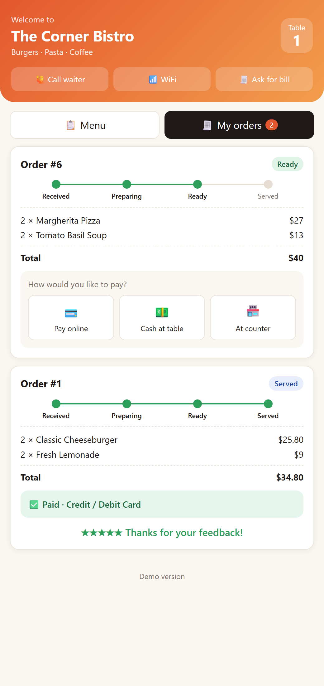
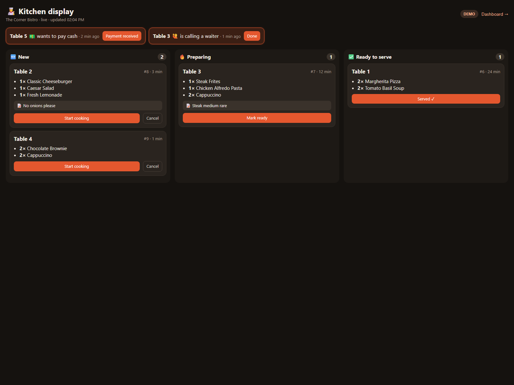
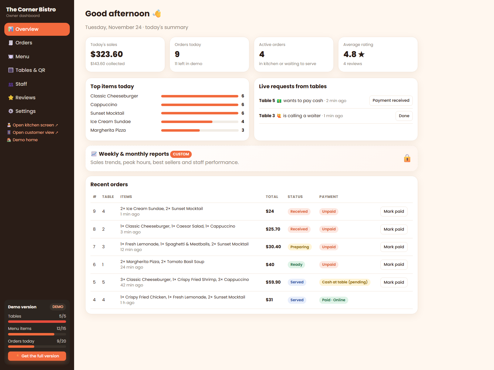
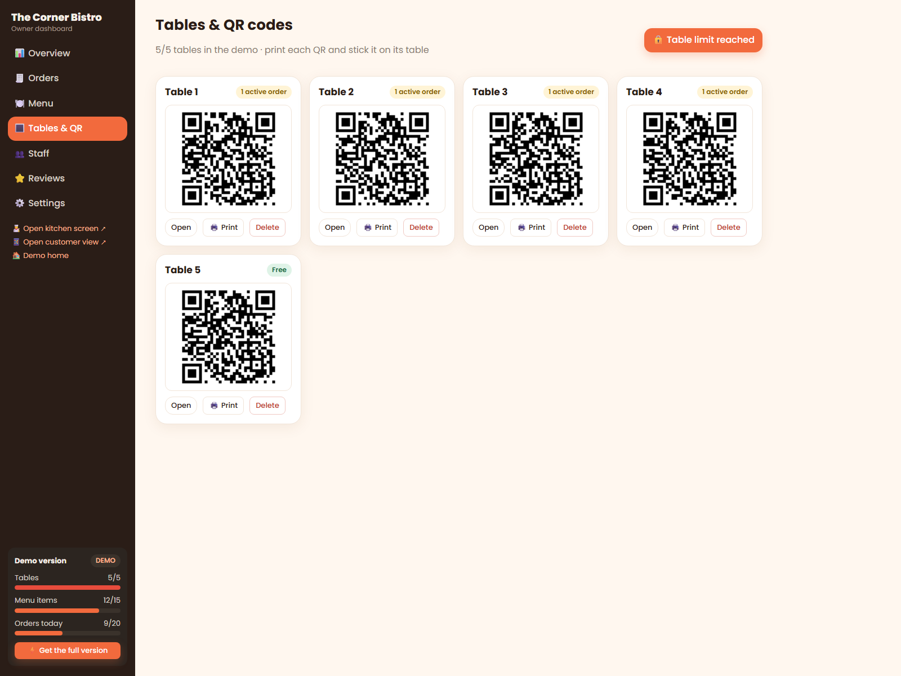

# QR Dine: smart QR ordering for restaurants

Every table gets its own QR code. Guests scan it to see the menu, order, call a waiter, get the WiFi password, pay and leave a review, all from their phone with no app to install. Orders appear instantly on the kitchen screen, and the owner sees sales, best sellers and reviews on a live dashboard.

### 🔗 [Try the live demo](https://qr-dine-demo.onrender.com)

Anyone can look around the menu, kitchen screen and dashboard. Placing orders and making changes needs an access code; DM us "QRDINE" for one. Tip: open the customer view and the kitchen screen side by side, place an order and watch it arrive.

| Guest menu | Order tracking |
|---|---|
|  |  |



| Owner dashboard | Tables & QR codes |
|---|---|
|  |  |

## Features

- **Guests:** digital menu by category, cart with special instructions, call waiter, ask for the bill, WiFi password, live order status (received → preparing → ready → served), pay online / cash at table / at counter, star rating and review
- **Kitchen:** live order board with sound alert, one tap to move orders along, late orders highlighted, waiter calls and payment requests
- **Owner:** today's sales and collected payments, best sellers, live table requests, orders with filters, menu editor (prices, sold out), tables with printable QR codes, staff, reviews, settings (name, WiFi, currency, tax)

## Demo vs custom version

This public demo is a single page with no server: data stays in the visitor's browser, so customer and kitchen sync between tabs on the same device. It is limited to 5 tables, 15 menu items and 20 orders a day, and online payments are simulated.

A custom version for a restaurant adds real-time sync across every phone and tablet, owner logins, real online payments, reports and order history, the restaurant's own branding and domain, receipt printers, WhatsApp/SMS alerts, multiple branches and languages.

## Project layout

```
index.html                  the whole demo (HTML, CSS link and JavaScript)
style.css                   styles
scripts/make_screens.py     takes docs/screenshots with headless Edge (loads sample orders)
scripts/make_social.py      renders docs/social/slides.html into Instagram slides + LinkedIn PDF
scripts/set_access_code.py  changes the access code
docs/screenshots/           README and slide screenshots
docs/social/                carousel source, Instagram PNGs, LinkedIn PDF
```

## Settings (top of `index.html`)

| Setting | What it does |
|---|---|
| `DEVELOPER` | Your brand name, WhatsApp number, email and Instagram handle (contact buttons, "Powered by") |
| `ACCESS_CODE_SHA256` | Hash of the access code (the code itself is never stored); change with `python scripts/set_access_code.py NEW-CODE` |
| `DM_KEYWORD` | Word visitors DM you for a code |
| `LIMITS` | Demo limits: tables, menu items, orders per day |
| `PUBLIC_URL` | Live demo link, used for QR codes in screenshots |

Add `?sample=1` to the link to load a set of sample orders (or Settings → Load sample orders).

The access code is checked in the browser (only its hash is in the page). It keeps casual visitors to "look only", but it is not real security; that's fine here because the demo has no server, data or costs behind it.

## Deploy on Render (free)

1. Push this folder to a GitHub repository.
2. On **render.com**: **New → Static Site**, pick the repository.
3. Build command: leave empty. Publish directory: `.`
4. **Create Static Site.** Static sites on Render don't sleep, so the link opens instantly.

If Render gives a different link than `https://qr-dine-demo.onrender.com`, update `PUBLIC_URL` and the link above, then run `python scripts/make_screens.py` and `python scripts/make_social.py` again.
